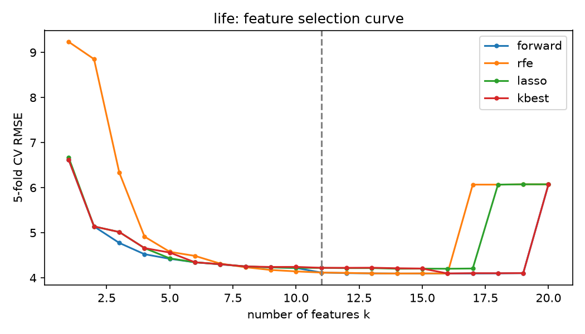
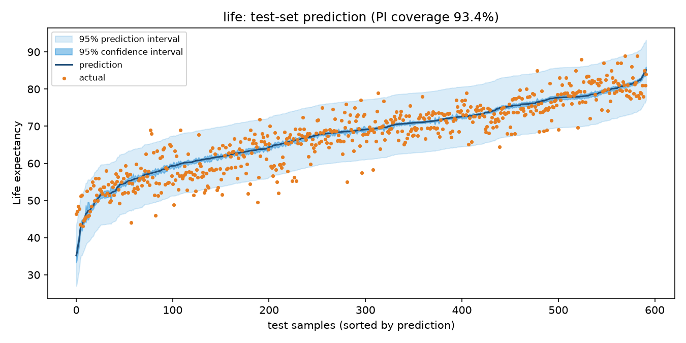
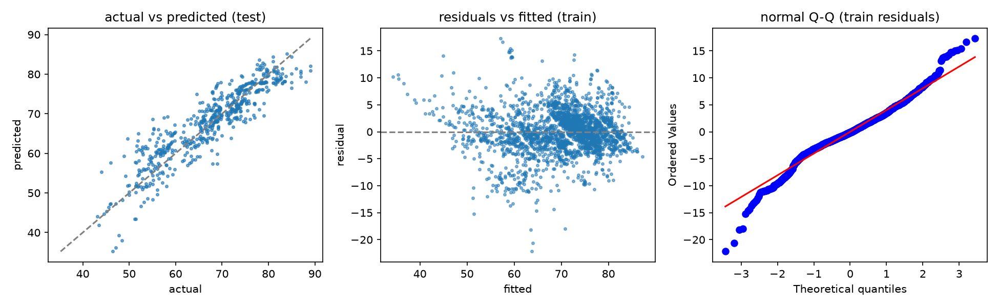

# HW2 報告：多元線性回歸 × CRISP-DM

> 主題：以 WHO 健康與經濟指標預測各國平均壽命（主題一），並以洪水預測資料集作為第二個問題（主題二）
> 線上展示：`<Streamlit 網址>`　｜　GitHub：[TedLin2002/HW2-MultipleLR](https://github.com/TedLin2002/HW2-MultipleLR)
> 重現方式：`python analysis.py`（產生 `figures/` 中所有圖表與 `results.json`）；互動版：`streamlit run app.py`

## 0. 資料來源

| 問題 | Kaggle 資料集 | 樣本數 | 特徵數（不含 y） | 目標 y |
|---|---|---|---|---|
| 主題一 | [Life Expectancy (WHO)](https://www.kaggle.com/datasets/kumarajarshi/life-expectancy-who) | 2,938 | 21 | `Life expectancy`（歲） |
| 主題二 | [Flood Prediction Dataset](https://www.kaggle.com/datasets/naiyakhalid/flood-prediction-dataset) | 3,000（50,000 筆中抽樣） | 20 | `FloodProbability` |

兩個資料集的特徵數都介於 14 到 39 之間，符合題目「>13 個特徵」的要求。CSV 檔取自 GitHub 上的公開鏡像：[pmaji/data-science-toolkit](https://github.com/pmaji/data-science-toolkit/blob/master/regression/data/life_expectancy.csv) 與 [chayi27/AIoT-DIC2-MultipleLR-](https://github.com/chayi27/AIoT-DIC2-MultipleLR-/blob/main/data/flood_data.csv)，存於 `data/`。

以下以 **主題一（平均壽命）** 為主要分析對象。主題二的結果列在第 7 節。

---

## 1. Business Understanding（商業理解）

- **問題**：WHO 與各國衛生部門預算有限，需要知道哪些因素（疫苗覆蓋率、教育、死亡率、經濟）最能解釋一國的平均壽命，才能把資源投入最有效的項目。
- **目標**：建立可解釋的多元線性回歸模型，預測國家年度平均壽命，並量化每個因子的影響方向與大小。
- **成功標準**：測試集 RMSE < 4.5 歲、R² > 0.8，95% 預測區間的實際覆蓋率接近 95%。

## 2. Data Understanding（資料理解）

- 193 國 × 2000–2015 年，共 2,938 筆、22 欄（`Country`、`Year`、`Status` 與 18 個數值指標，以及目標 `Life expectancy`）。
- 缺失值：`Population`（652）、`Hepatitis B`（553）、`GDP`（448）、`Total expenditure`（226）等，目標值缺 10 筆。
- 與目標相關性最高的欄位：`Schooling`、`Adult Mortality`（負相關）、`Income composition of resources`、`HIV/AIDS`（負相關）、`BMI`。
- **資料品質問題**：`infant deaths` 與 `under-five deaths` 幾乎完全共線。`Population` 與 `GDP` 有數量級錯誤（同一國家相鄰年份相差 100 倍以上），這是 Kaggle 討論區常見的問題。
- 同一個國家有 16 年資料，各列之間並非獨立。

## 3. Data Preparation（資料準備）

1. 刪除目標缺失的 10 筆資料，並排除識別欄位 `Country`。
2. **依國家分組切分訓練／測試集（GroupShuffleSplit，80/20）**：同一國家只會出現在其中一邊，避免模型「背」下國家而高估表現。訓練集 2,336 筆，測試集 592 筆。
3. 數值缺失值以**訓練集中位數**填補，共 2,513 格。
4. `Status`（Developed / Developing）做 One-Hot 編碼，並使用 `drop_first` 避免虛擬變數陷阱。
5. 前處理後共 20 個可用特徵。

所有前處理參數都只由訓練集估計，再套用到測試集。

## 4. Modeling（建模與特徵選擇）

### 4.1 特徵選擇

比較四種方法。每種方法先產生完整的特徵排序，再對前 k 個特徵做 **5-fold 交叉驗證**，計算 RMSE 與 Adjusted R²：

| 方法 | 說明 | 建議 k |
|---|---|---|
| Forward Stepwise | 每次加入使 CV R² 提升最多的特徵 | **11** |
| RFE | 標準化後遞迴刪除係數最小的特徵 | 11 |
| Lasso (L1) | 依特徵在正則化路徑上進入模型的順序排序 | 9 |
| SelectKBest (F 檢定) | 依單變量 F 統計量排序 | 16 |

「建議 k」的定義是：CV RMSE 與最佳值相差 1% 以內的最小 k，也就是在表現幾乎不變的前提下選最精簡的模型。

四種方法的曲線在 k≈10 之後都趨於平坦。值得注意的是，**`Population` 一加入，CV RMSE 就從約 4.1 跳到約 6.1**。原因是該欄位有極端錯誤值（約 10⁹），導致係數外插失準。這也是本作業中特徵選擇效果最明顯的例子。

### 4.2 最終模型（Forward Stepwise，k = 11，OLS）

| 特徵 | 係數 | 95% CI | 解讀 |
|---|---|---|---|
| (截距) | 55.31 | [54.02, 56.60] | |
| Schooling | +0.766 | [0.675, 0.858] | 平均受教育年數每多 1 年，壽命約 +0.77 歲 |
| Adult Mortality | −0.0214 | [−0.0232, −0.0196] | 每千人成人死亡數 +100，壽命約 −2.1 歲 |
| HIV/AIDS | −0.448 | [−0.493, −0.403] | |
| Income composition of resources | +4.80 | [3.40, 6.19] | 人類發展指數的收入面向（0–1） |
| Status_Developing | −1.81 | [−2.36, −1.25] | 開發中國家比已開發國家約少 1.8 歲 |
| Polio / Diphtheria | +0.036 / +0.032 | 皆顯著 | 疫苗覆蓋率每 +10%，壽命約 +0.3 歲 |
| BMI | +0.049 | [0.039, 0.059] | |
| GDP | +4.1e-5 | 顯著 | 每人 GDP +10,000 美元，壽命約 +0.4 歲 |
| under-five deaths / infant deaths | −0.074 / +0.098 | 皆顯著 | 兩者高度共線（VIF≈176），應合併解讀 |

所有係數的 p 值都小於 0.001。

## 5. Evaluation（評估）

### 5.1 指標

| 資料集 | MAE | MSE | RMSE | R² | Adjusted R² |
|---|---|---|---|---|---|
| 訓練集 | 3.00 | 16.68 | 4.08 | 0.812 | 0.811 |
| **測試集（未見過的國家）** | **3.13** | **16.74** | **4.09** | **0.821** | **0.817** |

訓練集與測試集的表現幾乎相同，代表沒有過度配適，模型也能推廣到沒看過的國家。

### 5.2 預測圖（95% 信賴區間 + 預測區間）

- **深藍帶：信賴區間（CI）**，表示「平均」壽命 E[y|x] 的不確定性。因為樣本數多，區間很窄。
- **淺藍帶：預測區間（PI）**，表示「單一國家某年」壽命的不確定性，約為 ±8 歲。
- 測試集有 **93.4%** 的實際值落在 95% 預測區間內，接近理論值 95%，代表區間估計大致可信。

### 5.3 模型比較（測試集）

| 模型 | 特徵數 | RMSE | R² |
|---|---|---|---|
| OLS 全部特徵 | 20 | 6.73 | 0.515 |
| **OLS 選取特徵（Forward）** | **11** | **4.09** | **0.821** |
| Ridge（CV α） | 20 | 4.06 | 0.823 |
| Lasso（CV α） | 20 | 4.06 | 0.824 |

用 11 個特徵的 OLS，表現與正則化模型幾乎相同，且比全部特徵的 OLS 好得多（R² 從 0.52 提升到 0.82），同時保留了易於解釋的係數與信賴區間。

### 5.4 回歸假設檢查

| 假設 | 檢定 | 結果 | 說明 |
|---|---|---|---|
| 線性 | 殘差 vs 預測值 | 大致無明顯曲線 | 低壽命區略有偏差 |
| 誤差獨立 | Durbin–Watson = 0.70 | 違反 | 同一國家逐年資料具時間相關（面板資料特性） |
| 常態 | Jarque–Bera p < 0.001 | 尾部偏厚 | 少數國家（如戰亂、愛滋高峰期）殘差很大 |
| 同質變異 | Breusch–Pagan p < 0.001 | 違反 | 低壽命國家變異較大 |
| 無多重共線 | VIF | infant / under-five deaths ≈ 176 | 其餘特徵 < 3.2 |

**限制與改進方向**：面板資料的自相關與異質變異會讓 OLS 的標準誤偏低，因此 CI 可能過窄。可改用穩健（HC3）或依國家分群（cluster-robust）的標準誤、固定效果模型，或刪除兩個嬰幼兒死亡欄位中的一個。

## 6. Deployment（部署）

使用 **Streamlit** 部署互動式網頁（`app.py`），功能如下：

- **下拉選單切換兩種問題**：WHO 平均壽命／洪水機率（加分項 1）。
- **自訂資料集**：輸入任意 CSV 網址（例如 [50_Startups.csv](https://raw.githubusercontent.com/Avik-Jain/100-Days-Of-ML-Code/master/datasets/50_Startups.csv)），可選擇目標與排除欄位，類別欄位會自動做 One-Hot 編碼（加分項 2）。
- 側邊欄可調整測試集比例、特徵選擇方法、k 值與信賴水準（80/90/95/99%）。
- 六個分頁對應 CRISP-DM 六個階段，包含相關係數熱圖、k 曲線、係數表、預測區間圖、殘差診斷與 VIF。
- Deployment 分頁可輸入新樣本，即時取得預測值、CI 與 PI，並顯示單一特徵的效果曲線，也能下載測試集預測結果 CSV。

## 7. 主題二：Flood Prediction 結果摘要

- 20 個 1–10 分的治理與環境指標，沒有缺失值。
- 四種特徵選擇方法的建議 k 都是 **20**：每個特徵的係數都約為 0.0045，且全部顯著。這表示洪水機率近似於所有指標的等權加總，刪除任何一個特徵都會讓表現下降。
- 測試集 **R² = 0.849、RMSE = 0.0171**，95% PI 覆蓋率為 **96.0%**。
- 殘差分析通過所有假設檢定：DW = 2.00，JB p = 0.49，BP p = 0.65。這是一個非常「教科書式」的線性問題，與主題一（真實、髒的面板資料）形成對比。

---

## 8. GPT 輔助內容

> 以下標示本作業中由 AI（ChatGPT 與 Claude Code）協助完成的部分。對話紀錄 PDF：`chat_logs/01_ChatGPT_選題對話.pdf`（ChatGPT 選題對話，由對話內容複製轉存）、`chat_logs/02_ClaudeCode_開發對話.pdf`（Claude Code 開發過程整理）。

| 項目 | AI 協助內容 | 本人工作 |
|---|---|---|
| 選題 | ChatGPT 列出符合「14–39 個特徵」的 Kaggle 回歸題目並比較其適用性 | 最終選定 WHO Life Expectancy 與 Flood Prediction |
| 程式 | Claude Code 協助撰寫 `mlr.py`（前處理、四種特徵選擇、OLS 區間估計、假設檢定）、`app.py`（Streamlit 介面）與 `analysis.py` | 執行、檢查結果、調整參數 |
| 除錯／分析 | AI 協助找出「全部特徵 OLS 測試 R² 僅 0.52」的原因是 `Population` 極端值，並建議改用依國家分組切分 | 確認結論並寫入報告 |
| 報告 | AI 協助草擬 CRISP-DM 各節文字 | 校對、補充個人解讀 |

## 9. NotebookLM 摘要

> **狀態：待補。** 請把下列來源加入 NotebookLM，並提問：「這些研究如何用回歸模型預測 WHO 平均壽命？使用了哪些特徵、前處理方法，得到什麼結果？」接著將 NotebookLM 的實際回答（100 字以上）貼在本節，並附上截圖 `chat_logs/03_NotebookLM.png`。
>
> 來源：[Kaggle 資料集頁面](https://www.kaggle.com/datasets/kumarajarshi/life-expectancy-who)、[arXiv 2510.00542](https://www.arxiv.org/pdf/2510.00542)、[IJSS: Predicting Life Expectancy using ML](https://banglajol.info/index.php/ijss/article/view/81045)、[i-JOE: Life Expectancy Prediction through Immunization and HDI Factors](https://online-journals.org/index.php/i-joe/article/view/33315)、[EnjoyAlgorithms: Life expectancy prediction using linear regression](https://enjoyalgorithms.com/blog/life-expectancy-prediction-using-linear-regression)

**（NotebookLM 回答貼於此處）**

### 9.1 參考：AI 整理的網路解法摘要（由 Claude Code 依網路搜尋整理，非 NotebookLM 產出）

網路上針對 WHO Life Expectancy 資料集的解法，大多遵循「清理缺失值 → 探索相關性 → 建立回歸模型 → 比較指標」的流程。常見做法是刪除含缺失值的資料列或填補缺失值，接著標準化特徵，再依 p 值與 R² 篩選變數。一篇以 Boruta 與正則化隨機森林（RRF）做特徵篩選的研究指出，HIV/AIDS、成人死亡率、受教育年數（Schooling）與收入組成指數（Income composition of resources）是最重要的預測因子，這與本作業 Forward Stepwise 選出的前幾名一致。該研究比較八種模型，Random Forest 表現最好（R² = 0.969），線性回歸與神經網路則表現最差。另一篇研究以 bagging 方法達到約 97% 的 R²，同樣發現 HIV/AIDS、成人死亡率與收入組成最具影響力。arXiv 論文則比較線性回歸、回歸決策樹與隨機森林，並用 p 值與特徵重要度解讀模型。整體而言，線性回歸在這個資料集上通常作為可解釋性高、但準確度不如樹狀集成模型的基準模型；本作業測試集 R² = 0.82 的結果也符合這個定位。
